# Parte I. Introducción

## Qué es el Minino Reforjado

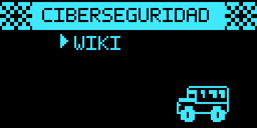

Guía de uso de cada app y ajuste del **Minino Reforjado**.

> **Nota sobre el nombre:** el proyecto se llamó antes *camioneta*. El nombre hacía referencia a la forma del layout, parecida a una camioneta de Guatemala. Ahora se llama **Minino Reforjado**; algunas capturas de pantalla en esta wiki todavía muestran el nombre anterior.

### Qué es

El Minino Reforjado es un dispositivo portátil para pruebas de seguridad WiFi y Bluetooth, basado en un **ESP32-C6**. Tiene pantalla OLED, 4 botones de navegación, buzzer, 9 NeoPixels y lector de SD, y no necesita PC ni conexión a internet para funcionar — todo se maneja desde su propia pantalla y botones, aunque varias apps también se pueden controlar por cable o por WiFi desde una PC.

Es un proyecto educativo de ciberseguridad hecho en Tesla Lab (Universidad Galileo): sirve para mostrar en vivo cómo funcionan ataques y técnicas comunes contra redes WiFi y Bluetooth (portales cautivos, flood de APs, spam de Bluetooth, sniffing de paquetes) y también para experimentar con RISC-V (la ALU corre nativamente en el C6, que es RISC-V) y con AES-128 usando el acelerador criptográfico de hardware del chip.

El hardware es conceptualmente igual al de [Minino](https://github.com/EDtheMaker/minino) de Electronic Cats, pero el layout físico y **todo el firmware son propios e independientes**

### Hardware

- **MCU:** ESP32-C6-WROOM-1U (antena externa por U.FL)
- **Pantalla:** OLED SH1106 128x64, I2C
- **NeoPixel:** 9 LEDs
- **Botones:** SELECT, UP, DOWN, BACK
- Buzzer, lector de tarjeta SD
- Alimentación: 2x celda 18650 vía PMIC/cargador + LDO a 3.3V
- Queda un header libre (3V3, TX, RX, GND, GPIO10, GND) para add-ons externos

Detalle completo de pines, esquemático y propuestas de mejora de hardware: ver el [README](https://github.com/PabloJLM/Minino_Reforjado#readme)

### Cómo está armado el firmware

Proyecto en **PlatformIO** (framework Arduino, board `esp32-c6-devkitc-1`). Cada pantalla del menú es un par de funciones `screenXLoop()` despachadas desde un `switch(currentScreen)` en `src/main.cpp`, con su entrada correspondiente en el `enum Screen` de `include/config.h`. El código está organizado en `lib/` por categoría: `Apps/` (las apps del menú), `Ajustes/` (pantallas de configuración), `Ayuda/` (pantallas de ayuda), `Drivers/` (lógica de bajo nivel reutilizable: AES, ALU RISC-V, mesh ESP-NOW, FTP, NeoPixel, buzzer, settings) y `Estaticos/` (splash y créditos).

Navegación en el dispositivo: **SELECT, UP, DOWN, BACK**.

```
MENU
├── APPS
│   ├── Wifi Captive Portal
│   ├── AP Flood
│   ├── Bluetooth Spam
│   ├── Sniffer
│   ├── PC-Mode
│   ├── BLE Scanner
│   ├── Mensajes ESP-NOW
│   ├── Terminal de Mensajes
│   ├── ALU RISC-V
│   └── AES Demo
├── AJUSTES
│   ├── Configuracion
│   ├── SD Storage
│   ├── NEOPIXEL
│   ├── Terminal Avanzada
│   ├── BT Spam
│   └── Con. Remota (FTP)
├── CREDITOS
└── AYUDA
```

### Apps

| App                                          | Qué hace                                                                                                                          |
| -------------------------------------------- | ---------------------------------------------------------------------------------------------------------------------------------- |
| [Wifi Captive Portal](#Wifi-Captive-Portal)   | Crea un AP con portal cautivo (HTML/CSS editable por SD) para pruebas de ingeniería social; registra quién se conecta en un log. |
| [AP Flood](#AP-Flood)                         | Llena el entorno de redes WiFi falsas con nombres configurables.                                                                   |
| [Bluetooth Spam](#Bluetooth-Spam)             | Manda anuncios BLE que disparan los popups de emparejamiento de Apple/Microsoft/Samsung/etc, con MAC distinta cada vez.            |
| [Sniffer](#Sniffer)                           | Captura paquetes WiFi del ambiente y los guarda en la SD.                                                                          |
| [PC-Mode](#PC-Mode)                           | Controla el dispositivo entero desde una terminal por cable USB.                                                                   |
| [BLE Scanner](#BLE-Scanner)                   | Busca y lista dispositivos Bluetooth cercanos (MAC).                                                                               |
| [Mensajes ESP-NOW](#Mensajes-ESP-NOW)         | Manda mensajes prehechos a otros Mininos Reforjados cercanos por ESP-NOW, sin WiFi ni internet.                                    |
| [Terminal de Mensajes](#Terminal-de-Mensajes) | Chat libre (texto propio) por ESP-NOW vía monitor serial.                                                                         |
| [ALU RISC-V](#Tutorial-RISCV)                 | ALU de 8 bits en ensamblador RISC-V, corriendo nativamente en el C6; modo simple en pantalla o avanzado por terminal serial/TCP.   |
| [AES Demo](#Tutorial-AES)                     | Cifrado/descifrado AES-128 real con el acelerador de hardware del C6: pasos del cifrado, intentos de clave y efecto avalancha.     |

### Ajustes

| Ajuste                                         | Qué hace                                                                                                          |
| ---------------------------------------------- | ------------------------------------------------------------------------------------------------------------------ |
| [Configuracion](#Ajustes-Configuracion)         | Splash, patrón de color de los NeoPixels, brillo, reset de fábrica.                                              |
| [SD Storage](#Ajustes-SD-Storage)               | Administrador de archivos de la SD por WiFi, accesible desde navegador (HTML/CSS personalizable).                  |
| [NEOPIXEL](#Ajustes-NEOPIXEL)                   | Control manual del color de los NeoPixels.                                                                         |
| [Terminal Avanzada](#Ajustes-Terminal-Avanzada) | Terminal por cable para configurar AP Flood, Sniffer, Captive Portal, BT Spam, WiFi remoto y las demos de ALU/AES. |
| [BT Spam](#Ajustes-BT-Spam)                     | Activa/desactiva qué fabricantes entran en la rotación de Bluetooth Spam.                                        |
| [Con. Remota (FTP)](#Ajustes-Con-Remota-FTP)    | Levanta AP + servidor FTP + terminal remota por TCP (puerto 2323), para manejar el dispositivo sin cable.          |

### Tutoriales

- [Tutoriales (conexión serial, FTP, terminal remota, SD)](#Tutoriales)

### Addons

- [Addons (módulos externos por UART / PCB dedicada)](#Addons)

# Parte II. Apps

## Wifi Captive Portal

Crea una red WiFi con un portal cautivo, para pruebas de ingeniería social: cualquiera que se conecte ve una página que le pide credenciales (o lo que tenga el portal, ya que el html y css es editable por SD), y queda registrado en un log.

### Cómo se usa

1. Entra a la app desde APPS → Wifi Captive Portal.
2. Si está **INACTIVO**, la pantalla muestra la carpeta de la SD que usa (`/portal/`) y el archivo de log (`captive_log.txt`).
3. SEL inicia el portal. Al quedar **ACTIVO** se muestra el SSID del AP y la IP para conectarse.
4. BACK detiene el portal (si está activo) y sale al menú.

### Contenido del portal

- El HTML/CSS del portal puede cargarse desde la SD (carpeta `/portal/`), con tu propio diseño.
- Si no hay nada en la SD, usa un portal por defecto que ya trae el firmware.

### Revisar capturas

El log (`captive_log.txt`) se puede revisar desde **PC-Mode** (comandos `logcap`, `logfull`, `logclear`, `logstats`) o directamente en la SD.

## AP Flood

Llena el entorno de redes WiFi falsas, para pruebas de saturación/spam de redes.

### Cómo se usa

1. Entra a la app desde APPS -> AP Flood.
2. La pantalla muestra el estado (**ACTIVO** / **IDLE**) y datos del flood en curso.
3. SEL prende o apaga el flood.
4. BACK sale al menú.

### Configurar los nombres de las redes

Los SSIDs se configuran desde **Terminal Avanzada** (Ajustes) con el comando:

```
flood{mensaje1,mensaje2,...}
```

hasta 6 nombres. También se puede ajustar el intervalo del flood:

```
apflood interval <ms>   (0 = lo más rápido)
```

**PC-Mode** también tiene su propio `flood{...}` para lo mismo, por si prefieres cargarlo desde ahí.

## Bluetooth Spam

Manda anuncios Bluetooth que hacen aparecer los popups de emparejamiento de distintos fabricantes, como hacen herramientas tipo ESP32Marauder. Cada anuncio sale con una dirección distinta para que el celular lo vea como un dispositivo nuevo cada vez.

### Fabricantes soportados

- Apple
- Microsoft
- Samsung
- Fast Pair
- Flipper Zero (no probado)

### Cómo se usa

1. Entra a la app desde APPS -> Bluetooth Spam.
2. La pantalla muestra el fabricante actual y el estado (**ON** / **OFF**).
3. SEL inicia o detiene el anuncio.
4. Mientras está activo, va rotando automáticamente entre los fabricantes habilitados (ver abajo), cada cierto tiempo.
5. BACK sale al menú (detiene el anuncio si estaba activo).

### Elegir qué fabricantes están disponibles

Desde **Ajustes -> BT Spam** hay una lista donde se activa/desactiva cada fabricante
Eso controla cuáles entran en la rotación de esta app.

## Sniffer

Captura paquetes WiFi del ambiente.

### Cómo se usa

1. Entra a la app desde APPS -> Sniffer.
2. La captura se guarda en la SD.

### Configuración

Desde **Terminal Avanzada** (Ajustes):

```
snifname <nombre>       (ej: snifname captura)
sniffer channel <1-13>
```

`snifname` define el nombre del archivo de captura en la SD, y `sniffer channel` fija en qué canal WiFi escucha.

## PC-Mode

Conecta el Minino Reforjado a una PC por cable USB y se maneja todo desde una terminal (monitor serial, 115200 baudios).

### Cómo se usa

1. Entra a la app desde APPS -> PC-Mode.
2. Conecta el monitor serial de tu PC al puerto del Minino Reforjado.
3. Escribe `help` para ver todos los comandos disponibles.
4. BACK en el dispositivo (o `exit`, según el comando disponible) regresa al menú.

### Comandos disponibles

| Comando           | Qué hace                                                |
| ----------------- | -------------------------------------------------------- |
| `help`          | esta ayuda                                               |
| `status`        | estado del sistema                                       |
| `info`          | información del device                                  |
| `rgb/R/G/B`     | control de NeoPixels                                     |
| `buzzer`        | prueba del buzzer                                        |
| `piano`         | mini piano por serial (notas: DO RE MI FA SOL LA SI DO2) |
| `ls`            | listar archivos de la SD                                 |
| `cat <archivo>` | ver un archivo de la SD                                  |
| `sdinfo`        | tipo y espacio de la SD                                  |
| `wifiscan`      | escanea redes WiFi cercanas                              |
| `flood{...}`    | SSIDs del AP Flood (máx. 6)                             |
| `logcap`        | últimos 5 logs del portal cautivo                       |
| `logfull`       | todos los logs del portal cautivo                        |
| `logclear`      | borrar el log del portal cautivo                         |
| `logstats`      | estadísticas del log                                    |
| `uptime`        | tiempo activo desde el último reinicio                  |
| `free`          | memoria heap disponible                                  |
| `whoami`        | usuario actual                                           |
| `uname`         | info del sistema/MCU                                     |
| `echo <texto>`  | repite el texto                                          |
| `reboot`        | reinicia el equipo                                       |
| `clear`         | limpiar pantalla                                         |

## BLE Scanner

Busca y muestra los dispositivos Bluetooth que hay cerca.

### Cómo se usa

1. Entra a la app desde APPS -> BLE Scanner.
2. Con el escaneo **OFF**, SEL lo inicia.
3. Con el escaneo **ON**, la pantalla muestra la cuenta de dispositivos encontrados y la lista (UP/DOWN mueve la selección).
4. Al seleccionar un dispositivo de la lista se muestra su MAC.
5. BACK sale al menú.

## Mensajes ESP NOW

Manda mensajes prehechos a otro(s) Minino(s) Reforjado(s) (o a todos los que estén cerca) por ESP-NOW, sin necesidad de red WiFi ni internet — solo que estén dentro de rango de radio.

### Cómo se usa

1. Entra desde APPS -> Mensajes ESP NOW.
2. **Elegir destino:** la pantalla muestra una lista `Todos` arriba, y debajo cada Minino Reforjado detectado (identificado por un ID de 4 caracteres hex, ej. `A3F2`).
   - UP/DOWN mueve la selección.
   - SEL confirma el destino y pasa al catálogo.
3. **Catálogo de mensajes:** con el destino ya elegido, UP/DOWN recorre una lista de mensajes prehechos:
   - Todo OK
   - Necesito ayuda
   - Reagrupar aqui
   - Objetivo visto
   - Retirada
   - Cargando bateria
4. SEL manda el mensaje seleccionado al destino elegido. Te quedas en el catálogo para mandar otro rápido.
5. Abajo de la pantalla, en vivo, se muestra el último mensaje recibido (o mandado) en la red: quién lo mandó, a quién, y el texto.
6. BACK en el catálogo regresa a elegir destino; BACK en la pantalla de elegir destino sale al menú de APPS.

### Notas

- El ESP-NOW solo está prendido mientras esta app está activa (se apaga al salir), para no chocar con el WiFi que usan otras apps del Minino Reforjado.
- `Todos` manda el mensaje a todos los Mininos Reforjados en rango. Elegir un Minino Reforjado específico de la lista lo manda solo a ese.
- La lista de destinos se arma sola conforme el Minino Reforjado va "viendo" a otros por ESP-NOW, si no aparece ninguno, puede que el otro Minino Reforjado no esté cerca o no tenga una app de mensajería abierta.

Para mandar texto libre (no solo mensajes prehechos) usa [Terminal de Mensajes](#Terminal-de-Mensajes).

## Terminal de Mensajes

Chat libre por ESP-NOW con uno o más Mininos Reforjados, usando el monitor serial (cable USB) como interfaz, para mandar texto libre, a diferencia de [Mensajes ESP NOW](#Mensajes-ESP-NOW) que solo manda mensajes prehechos.

### Cómo se usa

1. Entra desde APPS -> Terminal de Mensajes. La pantalla del dispositivo solo avisa "Ver monitor serial" — toda la interacción es por el monitor serial.
2. Abre el monitor serial de tu PC a **115200 baudios** (ver [Tutorial: Conexión serial](#Tutorial-Conexion-Serial)).
3. Al entrar se imprime un banner con tu propio ID (4 caracteres hex) y la lista de comandos.
4. Escribe comandos y Enter.

### Comandos

| Comando                     | Qué hace                                                                                     |
| --------------------------- | --------------------------------------------------------------------------------------------- |
| `send <texto>`            | manda el texto a TODOS los Mininos Reforjados en rango                                        |
| `sendto <id_hex> <texto>` | manda el texto a un Minino Reforjado específico (usa su ID, ej. `sendto A3F2 hola`)        |
| `nodes` / `ls`          | lista los Mininos Reforjados vivos detectados (ID, si es directa o por cuántos saltos llega) |
| `clear` / `cls`         | limpia la pantalla del monitor serial                                                         |
| `exit`                    | sale de la app y vuelve al menú de APPS                                                      |
| `help` / `?`            | vuelve a mostrar el banner con los comandos                                                   |

Los mensajes que te llegan de otros Mininos Reforjados se imprimen solos en cualquier momento (con un beep), sin que tengas que pedirlos.

BACK en el dispositivo también sale de la app, igual que escribir `exit`.

### Notas

- El ESP-NOW solo está prendido mientras esta app está activa.
- No hace falta WiFi ni internet — solo que los Mininos Reforjados estén dentro de rango de radio.
- Si un mensaje no llega, revisa con `nodes`/`ls` si el otro Minino Reforjado ya fue detectado.

# Parte III. Ajustes

## Configuracion

Ajustes generales del dispositivo.

### Cómo se usa

1. Entra desde AJUSTES -> Configuracion.
2. UP/DOWN mueve entre las opciones, SEL entra, BACK sale.

### Opciones

- **Splash** -> elige la pantalla de bienvenida
- **Color breath** -> elige el patrón de "respiración" de color de los NeoPixels
- **Brillo** -> ajusta el brillo general
- **Borrar toda la configuración** -> resetea todos los ajustes a los valores de fábrica

## SD Storage

Administrador de archivos de la SD **por WiFi**

Se puede acceder con cualquier navegador desde una PC o celular

### Cómo se usa

1. Entra desde AJUSTES -> SD Storage.
   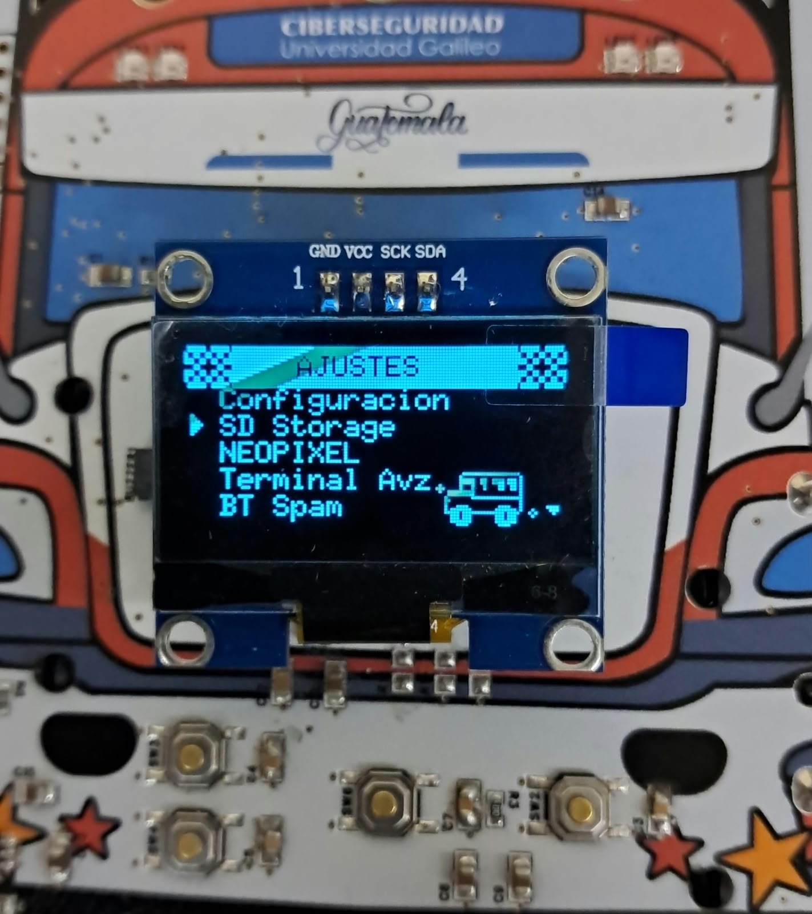
2. Inicia el servidor
   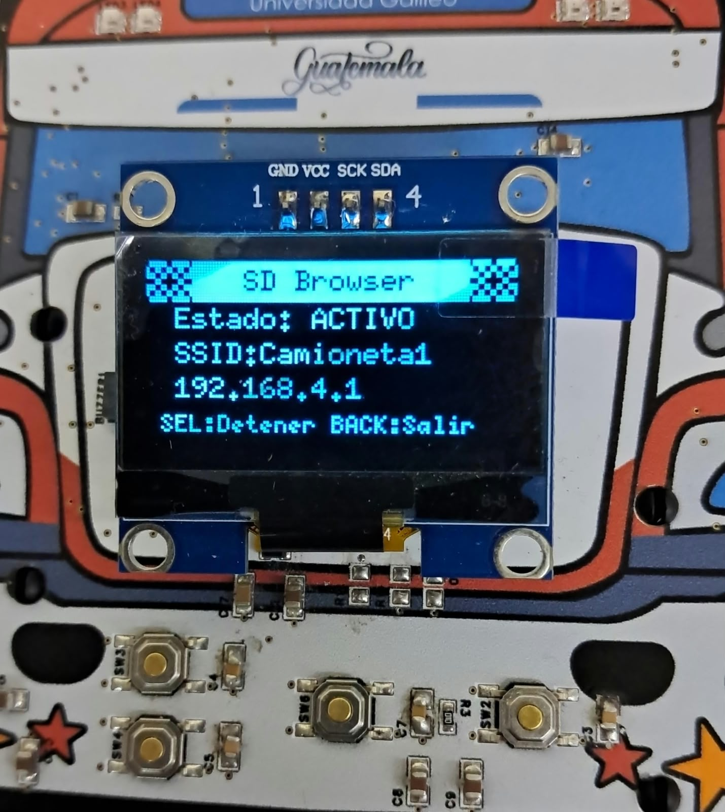
3. Desde una PC o celular, conéctate a esa red WiFi y entra a la IP mostrada para administrar los archivos.

   - Desde un celular
     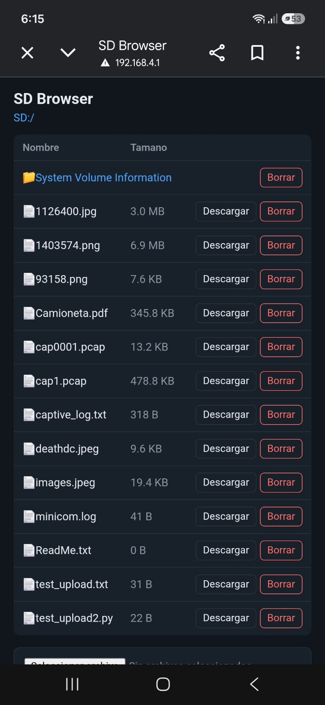
     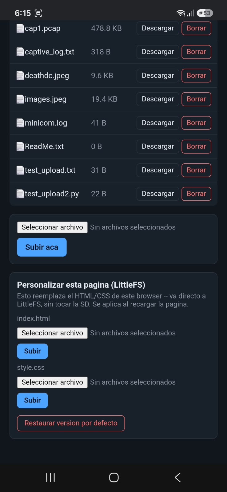
   - Desde una PC
     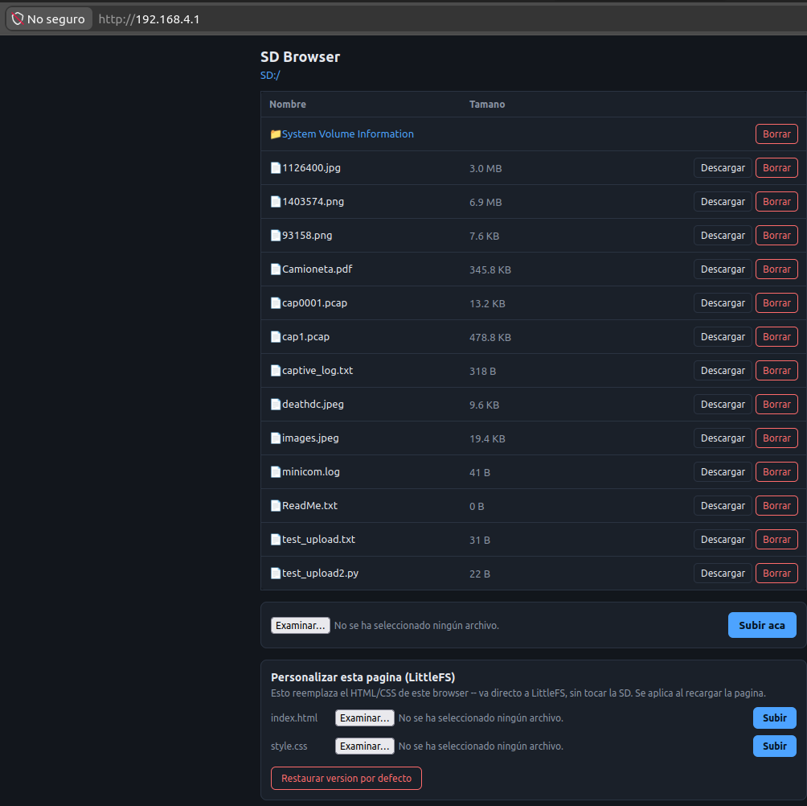
4. BACK detiene el servidor (si está activo) y sale al menú.

### Cómo personalizar el HTML del servidor

Se puede personalizar la forma y estetica del servidor para la SD, subiendo un html y un css con la forma deseada

#### Estructura mínima del HTML

```html
<!DOCTYPE html>
<html lang="es">
<head>
  <meta charset="UTF-8">
  <meta name="viewport" content="width=device-width, initial-scale=1">
  <title>Mi SD</title>
  <link rel="stylesheet" href="/style.css">   <!-- obligatorio -->
</head>
<body>
  <h1>Título</h1>
  <div id="crumbs"></div>                      <!-- ruta actual -->
  <table><tbody id="rows"></tbody></table>     <!-- lista de archivos -->
  <input type="file" id="file">                <!-- subir archivo -->
  <button onclick="doUpload()">Subir</button>
  <div id="status"></div>                      <!-- mensajes -->
  <script> /* copiar el JS del index.html de ejemplo */ </script>
</body>
</html>
```

#### Plantilla de colores del CSS

```css
:root{
  --bg:#58177a;      /* fondo */
  --title:#fbbe0f;   /* título y acentos */
  --panel:#43105d;   /* tablas y tarjetas */
  --edge:#7b2fa6;    /* bordes */
  --fg:#f5ecfb;      /* texto */
}
body{background:var(--bg);color:var(--fg)}
h1{color:var(--title)}
```

### Ejemplo de personalizacion

En este ejemplo se subira un html y css para cambiar los colores del servidor
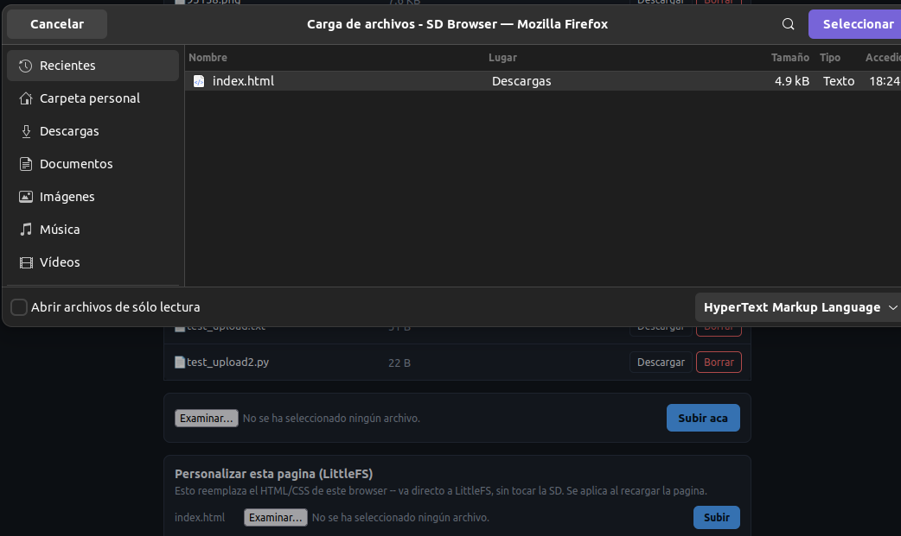
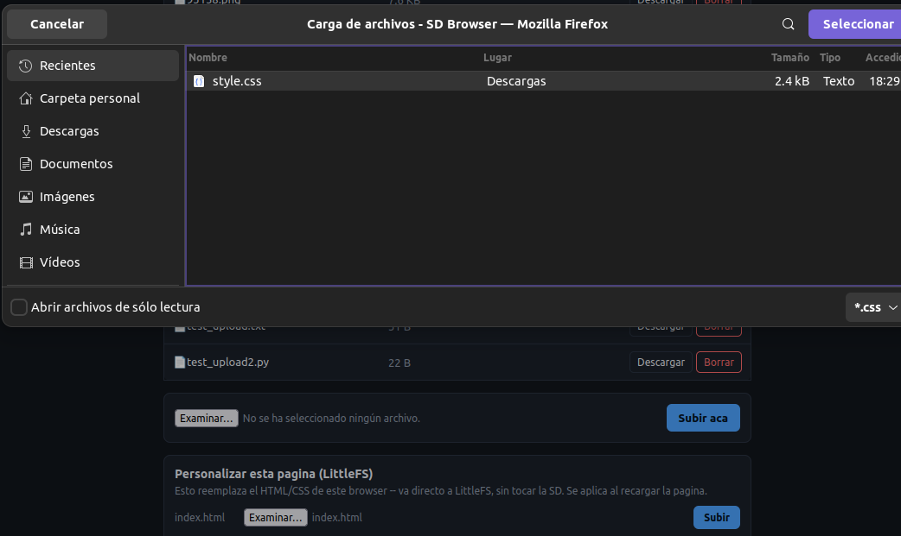
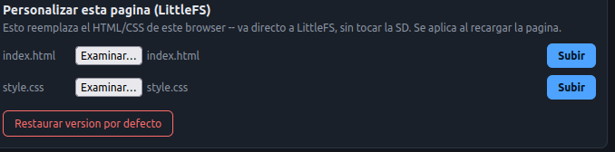

Luego subimos los archivos, veremos que debajo dira: **Listo, recarga la pagina para verlo**
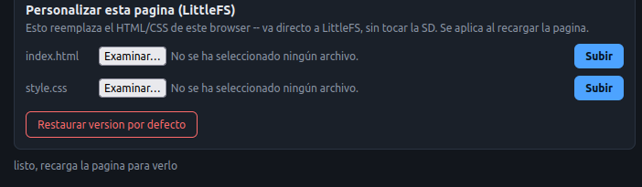

Recargamos la pagina y veremos que los cambios se aplicaron y asimismo se quedaron escritos en la memoria del microcontrolador
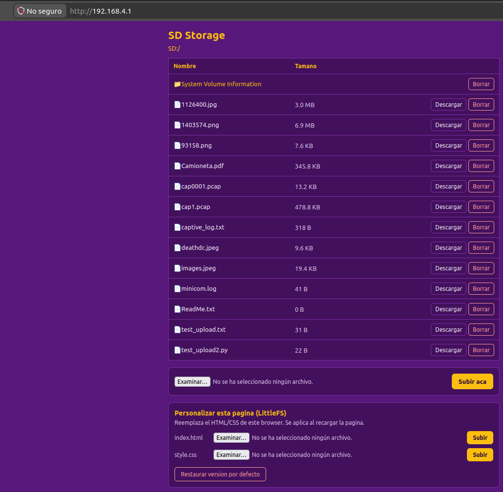
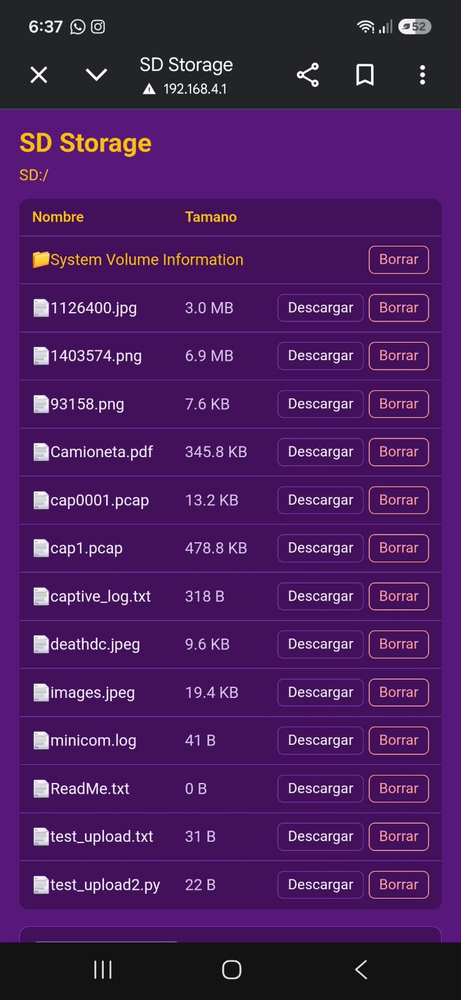

## NEOPIXEL

Para cambiar el color de los NeoPixels a mano.

### Cómo se usa

1. Entra desde AJUSTES -> NEOPIXEL.
2. La pantalla ("Neo Control") tiene tres canales: R, G, B.
3. UP/DOWN mueve la selección entre canales.
4. SEL sube el valor del canal seleccionado en pasos de 5 (al llegar a 255 vuelve a empezar). Mantener SEL presionado lo sube automáticamente.
5. El color se aplica en vivo a los 9 NeoPixels.
6. BACK sale al menú.

## Terminal Avanzada

Otra terminal por cable, separada de la de PC-Mode, pensada para configurar AP Flood, Sniffer, Captive Portal, BT Spam y la conexión WiFi, y lasas demos de [ALU RISC-V](#Tutorial-RISCV) y [AES](#Tutorial-AES).

### Cómo se usa

1. Entra desde AJUSTES -> Terminal Avz.
2. Conecta el monitor serial de tu PC (115200 baudios).
3. Escribe `help` para ver los comandos.

### Comandos principales

| Comando                                | Qué hace                                                 |
| -------------------------------------- | --------------------------------------------------------- |
| `help`                               | esta ayuda                                                |
| `status`                             | resumen de toda la configuracion                          |
| `flood{mensaje1,mensaje2,...}`       | SSIDs del AP Flood (máx. 6)                              |
| `floodshow`                          | lista los mensajes activos del AP Flood                   |
| `apflood interval <ms>`              | intervalo del AP Flood (0 = lo más rápido)              |
| `snifname <nombre>`                  | nombre del archivo de captura del Sniffer                 |
| `sniffer channel <1-13>`             | canal WiFi que escucha el Sniffer                         |
| `snifshow`                           | ajustes actuales del Sniffer                              |
| `portalsrc auto\|embebido\|sd\|fs`      | de dónde carga el HTML el Captive Portal                 |
| `portal ssid <nombre>`               | SSID del Captive Portal                                   |
| `portalshow`                         | ajustes actuales del Captive Portal                       |
| `btspam list`                        | fabricantes activos en BT Spam                            |
| `btspam enable\|disable <fabricante>` | activa/desactiva un fabricante del Bluetooth Spam         |
| `wifi ssid <nombre>`                 | red a la que se une en modo STA                           |
| `wifi pass <clave>`                  | contraseña de esa red                                    |
| `wifi mode ap\|sta`                   | modo WiFi del Minino Reforjado                            |
| `wifi apssid <nombre>`               | SSID del AP propio del Minino Reforjado                   |
| `wifi appass <clave>`                | contraseña del AP propio (mín. 8 caracteres)            |
| `wifishow`                           | ajustes actuales de WiFi remoto                           |
| `uptime`                             | tiempo activo desde el último reinicio                   |
| `free`                               | memoria heap disponible                                   |
| `echo <texto>`                       | repite el texto                                           |
| `alu ...`                            | demo de ALU RISC-V (`alu help` para ver sus comandos)   |
| `aes ...`                            | demo de AES-128 real (`aes help` para ver sus comandos) |
| `reboot`                             | reinicia el equipo                                        |
| `clear`                              | limpiar pantalla                                          |
| `exit`                               | salir de la terminal de ajustes                           |

## BT Spam (Ajustes)

Lista de fabricantes que puede usar la app **Bluetooth Spam**. Aquí se activa o desactiva cuáles entran en la rotación de esa app.

### Cómo se usa

1. Entra desde AJUSTES -> BT Spam.
2. UP/DOWN mueve la selección entre fabricantes.
3. SEL activa/desactiva el fabricante seleccionado.
4. BACK sale al menú de Ajustes.

Los marcados con `!` son los que no se han probado

## Con. Remota (FTP)

Conecta el Minino Reforjado a WiFi (crea su propio AP) y levanta un servidor FTP más una terminal remota por TCP (puerto 2323), para manejar el dispositivo sin cable.

### Cómo se usa

1. Entra desde AJUSTES → Con. Remota.
2. Si está **INACTIVO**, SEL la inicia.
3. Al quedar **ACTIVO** ("Modo: AP") se muestra la IP para conectarse.
4. Conéctate a esa red WiFi desde tu PC (o software como FileZilla / la terminal remota) usando esa IP.
5. BACK detiene el servicio (si está activo) y sale al menú.

### Terminal remota (puerto 2323)

Además del FTP, ese mismo modo ofrece una terminal por TCP con dos modos, elegibles al conectarte:

- **Regular** — comandos básicos, similares a los de PC-Mode.
- **Avanzada** — comandos de configuración, similares a los de Terminal Avanzada.

### LabVIEW

Se está armando un gestor en LabVIEW para usar esta conexión (FTP + terminal remota) desde una interfaz en PC, en vez de un cliente FTP genérico o la terminal a mano (aun en proceso)

# Parte IV. Tutoriales

## Tutoriales

Guías paso a paso para conectarte al Minino Reforjado desde tu PC.

1. [Conexión serial](#Tutorial-Conexion-Serial)
2. [Conexión remota con FileZilla al FTP](#Tutorial-FileZilla-FTP)
3. [Conexión a terminal remota con PuTTY](#Tutorial-PuTTY-Terminal-Remota)
4. [Conexión remota con terminal Linux al FTP](#Tutorial-Linux-FTP-Terminal)
5. [Terminal Avanzada](#Ajustes-Terminal-Avanzada)
6. [SD Storage](#Ajustes-SD-Storage)
7. [Mensajería ESP-NOW entre Mininos Reforjados](#Tutorial-Mensajeria-ESPNOW)
8. [Demo de RISC V (Valido para ESP32 C6 y C5)](#Tutorial-RISCV)
9. [Demo de AES-128](#Tutorial-AES)
10. [GUI de Python para la ALU](#Tutorial-GUI-ALU)

## Tutorial: Conexión serial

> **Nota sobre el nombre:** el proyecto se llamó antes *camioneta* El nombre hace referencia a la forma del layout, parecida a una camioneta de Guatemala. Ahora se llama **Minino Reforjado**; algunas capturas de pantalla en esta wiki todavía muestran el nombre anterior.

Cómo conectarte al Minino Reforjado por cable USB para ver sus mensajes y usar las terminales que van por Serial (PC-Mode, Terminal Avanzada, Ayuda).

### Qué necesitas

- Cable USB al Minino Reforjado
- Un monitor serial: el de Arduino IDE, PuTTY, o `screen`/`minicom` en Linux.

### Velocidad

El Minino Reforjado funciona a **115200 baudios**, 8N1 (8 bits, sin paridad, 1 bit de parada).

*Esta velocidad aplica a todas las terminales por cable del dispositivo (PC-Mode, Terminal Avanzada)*

### Arduino IDE

1. Conecta el cable USB.
2. Herramientas -> Puerto -> selecciona el puerto del Minino Reforjado (aparece como algo tipo `/dev/ttyUSB0`, `/dev/ttyACM0` en Linux, o `COMx` en Windows).
3. Herramientas -> Monitor Serie.
4. Abajo a la derecha del monitor, pon la velocidad en **115200 baud**.

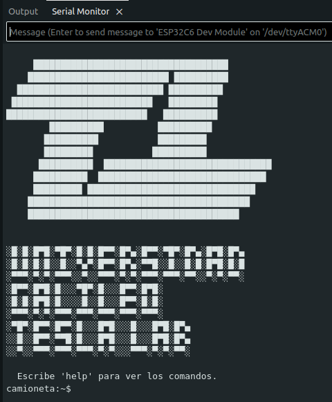

### PuTTY (Windows o Linux)

1. Abre PuTTY.
2. Tipo de conexión: **Serial**.
3. Serial line: el puerto (ej. `COM5` en Windows, `/dev/ttyUSB0` en Linux).
4. Speed: **115200**.
   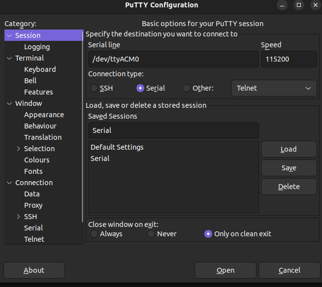
   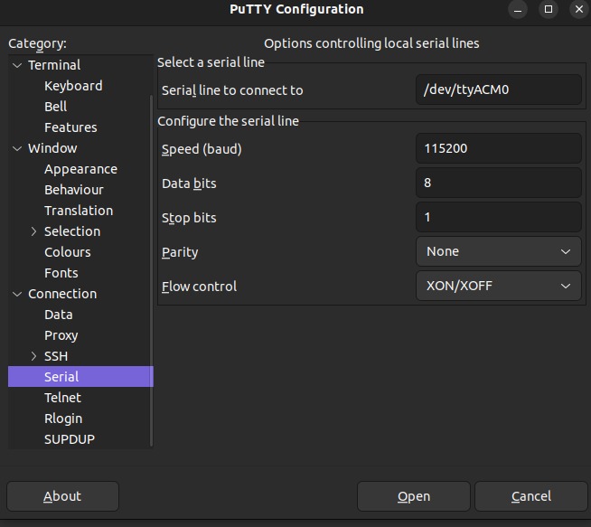
5. Open.
   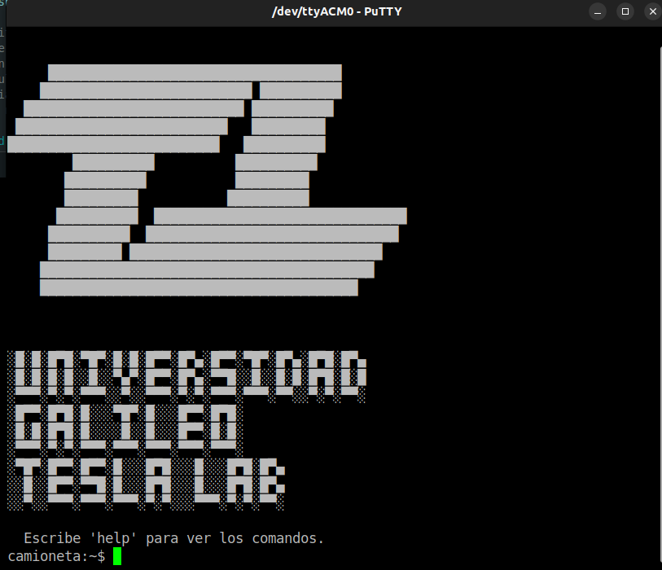

### Linux (terminal, sin PuTTY)

Con `screen` y el puerto en el que se encuentre conectada:

```
screen /dev/ttyACM0 115200
```

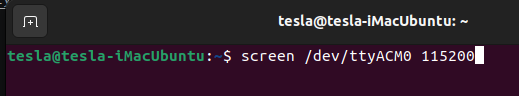

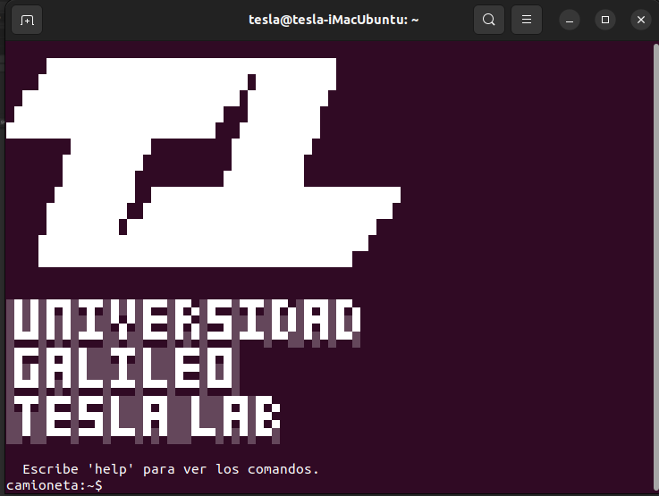

### Qué vas a ver

Al abrir el monitor vas a ver los mensajes de bienvenida e instrucciones que el Minino Reforjado imprime

*Escribe `help` para ver los comandos disponibles de esa pantalla.*
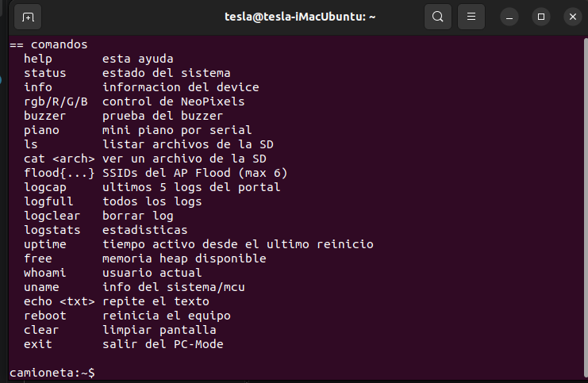

Para mas informacion de los comandos disponibles visita la pagina de [PC-Mode](#PC-Mode)

> Como podemos ver, todas las formas llevan al **mismo resultado**, poder interactuar con el Minino Reforjado por medio del puerto serial y su terminal.

## Tutorial: Conexión remota con FileZilla al FTP

> **Nota sobre el nombre:** el proyecto se llamó antes *camioneta* El nombre hace referencia a la forma del layout, parecida a una camioneta de Guatemala. Ahora se llama **Minino Reforjado**; algunas capturas de pantalla en esta wiki todavía muestran el nombre anterior.

Cómo conectarte con FileZilla al servidor FTP que levanta el Minino Reforjado en [Con. Remota (FTP)](#Ajustes-Con-Remota-FTP).

### 1. Activa Con. Remota en el Minino Reforjado

1. En el dispositivo: AJUSTES -> *Con. Remota*
2. Activa la conexion remota
3. Cuando quede **ACTIVO**, la pantalla muestra la red WiFi y la IP

### 2. Conéctate a la red WiFi del Minino Reforjado

Desde tu PC, conéctate a esa red WiFi *MininoReforjado-Remote* (la SSID es configurable)

### 3. Datos de conexión en FileZilla

Abre FileZilla y en la barra rápida (arriba) llena:

| Campo       | Valor           |
| ----------- | --------------- |
| Servidor    | `192.168.4.1` |
| Usuario     | `camioneta`   |
| Contraseña | `camioneta`   |
| Puerto      | `21`          |

Dale clic en **Conexión rapida**.

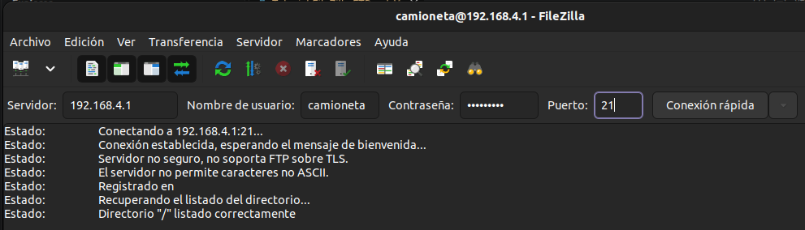

### 4. Arboles de archivos

Una vez conectado vas a ver el árbol de archivos de la SD del Minino Reforjado en el panel derecho.
Aca ya se pueden pasar archivos entre la pc local (izquierda) y el Minino Reforjado (derecha).

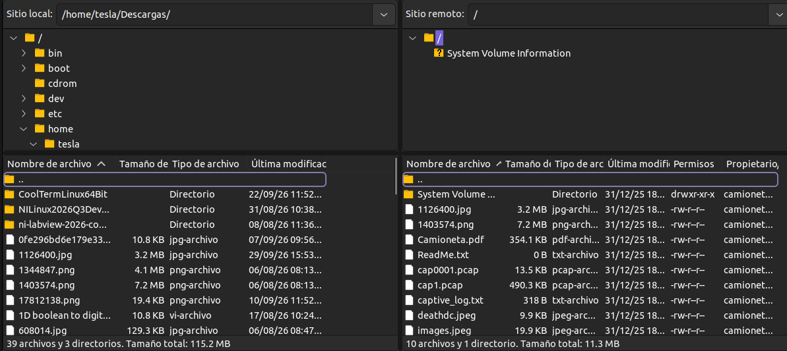

### 5. Transferencia de archivos

#### PC local -> Minino Reforjado

Una vez establecida la conexion, pasaremos un archivo desde nuestra PC hacia el Minino Reforjado
Para este ejemplo usaremos el siguiente archivo: **"93158.png"**, lo seleccionamos en el arbol
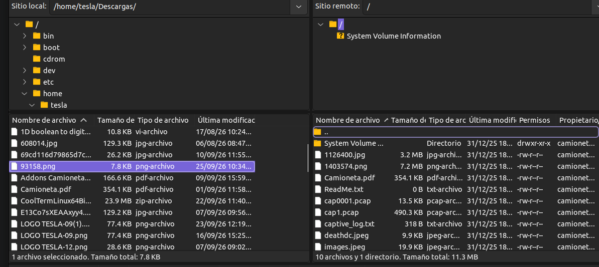

Hacemos doble click y veremos como se sube el archivo y aparece en el arbol correspondiente del Minino Reforjado
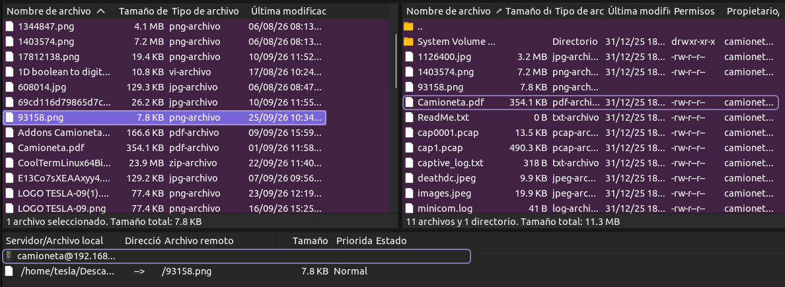

#### Minino Reforjado -> PC local

Para pasar archivos desde el Minino Reforjado hacia la pc local es la misma logica que se uso para el proceso anterior, seleccionamos y doble click, para este ejemplo descargaremos el archivo **"camioneta.pdf"** en el escritorio de la pc local
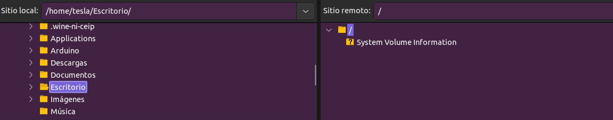
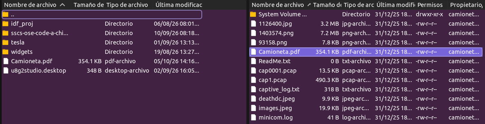

### Notas

- Solo hay un cliente FTP a la vez
- Debe usarse modo **FTP Pasivo**
- Con BACK se detiene el modo conexion remota

## Tutorial: Conexión a terminal remota con PuTTY

> **Nota sobre el nombre:** el proyecto se llamó antes *camioneta* El nombre hace referencia a la forma del layout, parecida a una camioneta de Guatemala. Ahora se llama **Minino Reforjado**; algunas capturas de pantalla en esta wiki todavía muestran el nombre anterior.

Cómo conectarte con PuTTY a la terminal remota por TCP (puerto 2323) de [Con. Remota (FTP)](#Ajustes-Con-Remota-FTP), sin usar el cable USB.

### 1. Activa Con. Remota en el Minino Reforjado

1. En el dispositivo: AJUSTES -> Con. Remota.
2. Iniciar la conexion
3. Conectarte al Wifi del Minino Reforjado

### 2. Configura PuTTY

1. Abre PuTTY.
2. Tipo de conexión: **Raw** (no usar SSH ni Telnet, la terminal remota usa texto sobre TCP).
3. Host Name (or IP address): `192.168.4.1`
4. Port: `2323`
5. Open.

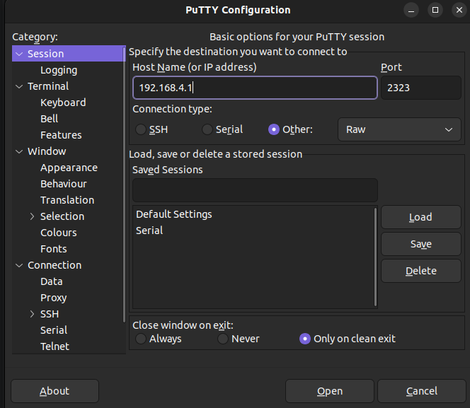

### 3. Elige el modo de terminal

Al conectar, el Minino Reforjado presenta los dos modos disponibles:

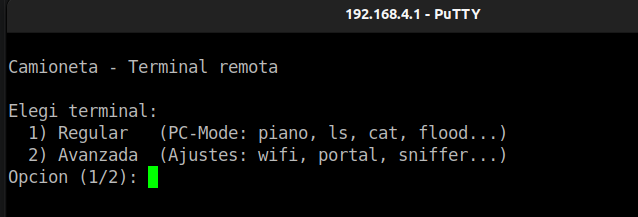

Escribe `1` o `2` y Enter según la terminal que se vaya a usar

#### Regular

los mismos comandos que PC-Mode por cable (ls, cat, flood, piano, etc)

Para mas informacion ver [PC-Mode](#PC-Mode)

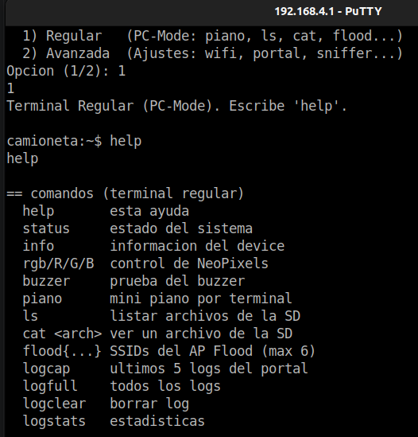

#### Avanzada

los mismos comandos que Terminal Avanzada por cable (wifi, portal, sniffer, btspam, etc)

Para mas informacion ver [Terminal Avanzada](#Ajustes-Terminal-Avanzada)

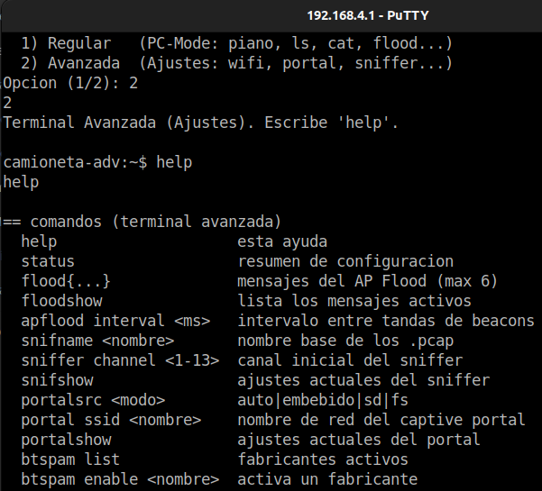

### Notas

- Es una sola terminal remota a la vez, no debe usarse al mismo tiempo que el FTP

## Tutorial: Conexión remota con terminal Linux al FTP

> **Nota sobre el nombre:** el proyecto se llamó antes *camioneta* El nombre hace referencia a la forma del layout, parecida a una camioneta de Guatemala. Ahora se llama **Minino Reforjado**; algunas capturas de pantalla en esta wiki todavía muestran el nombre anterior.

Cómo conectarte por línea de comandos (sin FileZilla) al servidor FTP de [Con. Remota (FTP)](#Ajustes-Con-Remota-FTP), usando `curl` o el cliente `ftp` de Linux.

### 1. Activa Con. Remota y conéctate a su WiFi

Igual que en el tutorial de [FileZilla](#Tutorial-FileZilla-FTP): AJUSTES -> Con. Remota y conéctate desde tu PC a la red WiFi que crea, luego a la IP **192.168.4.1**

### Datos de conexión

| Campo       | Valor           |
| ----------- | --------------- |
| Servidor    | `192.168.4.1` |
| Usuario     | `camioneta`   |
| Contraseña | `camioneta`   |
| Puerto      | `21`          |

### Con `curl`

Listar archivos:

```
curl -u camioneta:camioneta ftp://192.168.4.1/
```

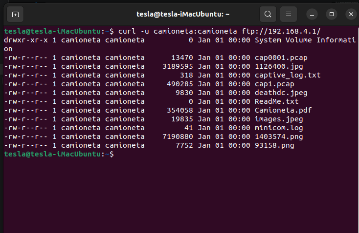

Bajar un archivo

En este caso bajaremos el archivo **"93158.png"** en el escritorio (se debe mover al directorio deseado, con cd)

```
curl -u camioneta:camioneta -o 93158.png ftp://192.168.4.1/93158.png
```

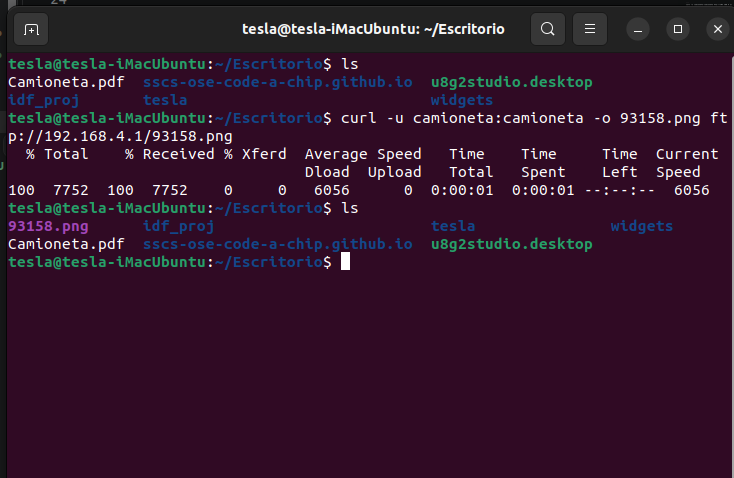
Como podemos ver al listar despues del comando vemos que el archivo ya se encuentra en el escritorio

Subir un archivo:

Primero crearemos un archivo de prueba en el escritorio para luego subirlo usando la terminal y curl
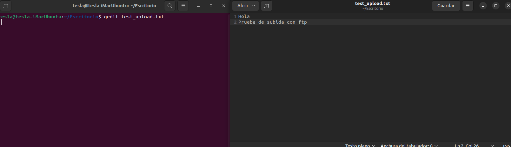
Una vez creado el archivo procedemos a subirlo

```
curl -u camioneta:camioneta -T test_upload.txt ftp://192.168.4.1/
```

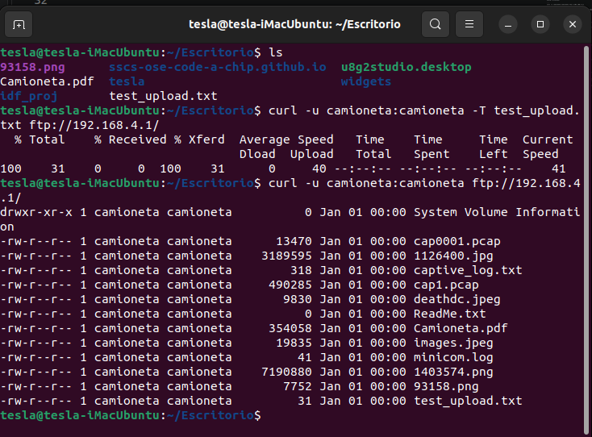
Luego de haberlo subido listamos para comprobar que si se haya subido

### Con el cliente `ftp` clásico

```
ftp 192.168.4.1
```

Te va a pedir usuario y contraseña (`camioneta` / `camioneta`)
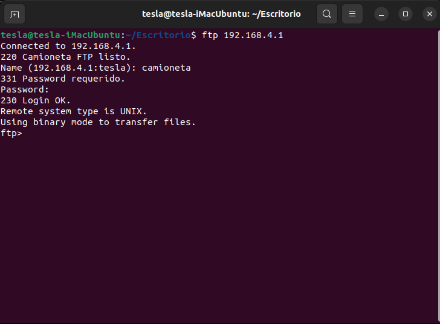

Una vez dentro podemos usar los siguientes comandos:

- `ls` — lista archivos
  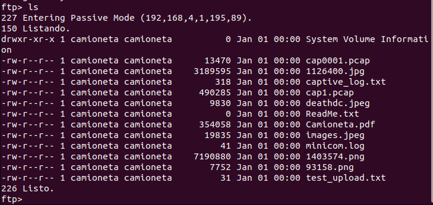
- `get archivo.txt` — descarga

  Para este ejemplo bajaremos el archivo **"cap1.pcap"**
  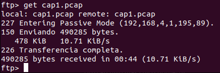

  Luego verificamos con otra terminal en el directorio (escritorio en este caso) y podemos ver que si se descargo correctamente
  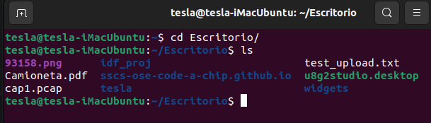
- `put archivo.txt` — sube

  Para este ejemplo crearemos y subiremos otro archivo llamado test_upload2.py (usamos la extension de python solo para probar que cualquier tipo de archivo se puede subir)
  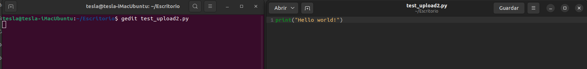

  Ahora subimos el archivo
  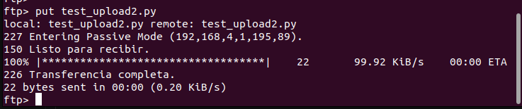

  Finalmente listamos para comprobar que si se subio correctamente
  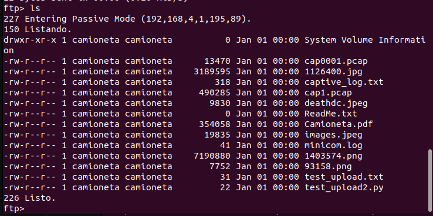
- `bye` — cierra la conexión

  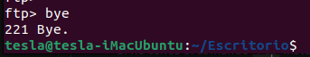

Si no tienes el comando `ftp` instalado, instalalo con `sudo apt install ftp` (en Ubuntu)

### Notas

- Solo hay un cliente FTP a la vez
- Debe usarse modo **FTP Pasivo**
- Con BACK se detiene el modo conexion remota

## Tutorial: Mensajería ESP-NOW entre Mininos Reforjados

> **Nota sobre el nombre:** el proyecto se llamó antes *camioneta* El nombre hace referencia a la forma del layout, parecida a una camioneta de Guatemala. Ahora se llama **Minino Reforjado**; algunas capturas de pantalla en esta wiki todavía muestran el nombre anterior.

Cómo mandar mensajes entre dos (o más) Mininos Reforjados usando ESP-NOW, sin WiFi ni internet, solo necesitan estar en rango entre si

### Qué necesitas

- Dos o más Mininos Reforjados encendidos y en rango de radio
- Para [Terminal de Mensajes](#Terminal-de-Mensajes) además necesitas cable USB y un monitor serial en al menos uno de los Mininos Reforjados (ver [Tutorial: Conexión serial](#Tutorial-Conexion-Serial)).

### Opción A: mensajes prehechos rápidos

Usa [Mensajes ESP NOW](#Mensajes-ESP-NOW) cuando solo necesitas avisar algo rápido del catálogo (Todo OK, Necesito ayuda, Reagrupar aqui, etc), sin cable.

Primero, se debe entender que cada Minino Reforjado tiene su propia direccion MAC, puede ser obtenida de diversas formas.
En este caso ya sabemos las direcciones MAC de los dos Mininos Reforjados que usaremos:

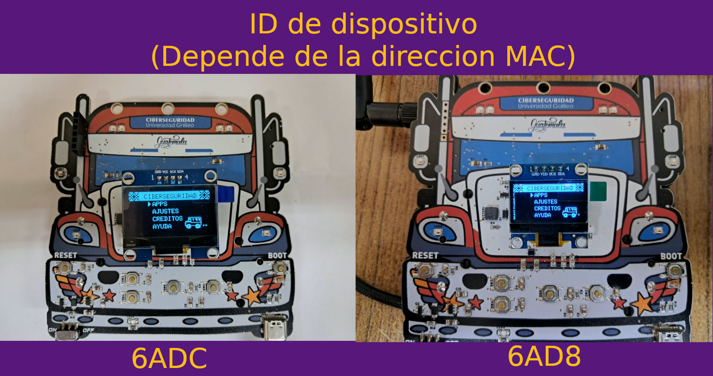

1. En cada Minino Reforjado que quieras que participe: APPS -> Mensajes ESP NOW.
   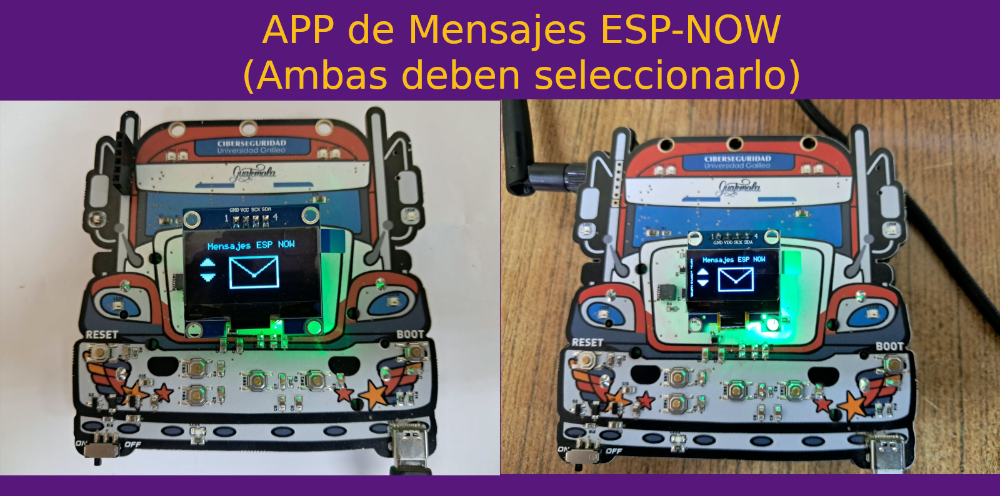
2. En la pantalla de elegir destino, esperá un momento a que aparezcan los demás Mininos Reforjados detectados
   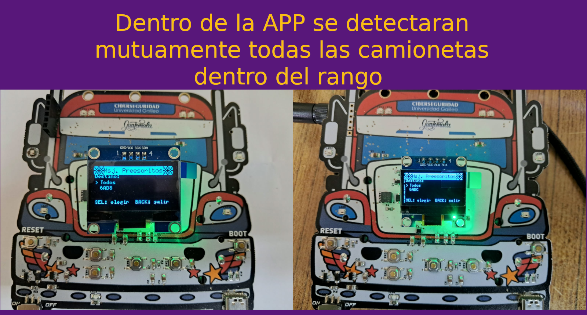
3. Elige `Todos` (para avisar a todos) o un Minino Reforjado específico de la lista
4. En el catálogo, UP/DOWN para elegir el mensaje y SEL para mandarlo.
   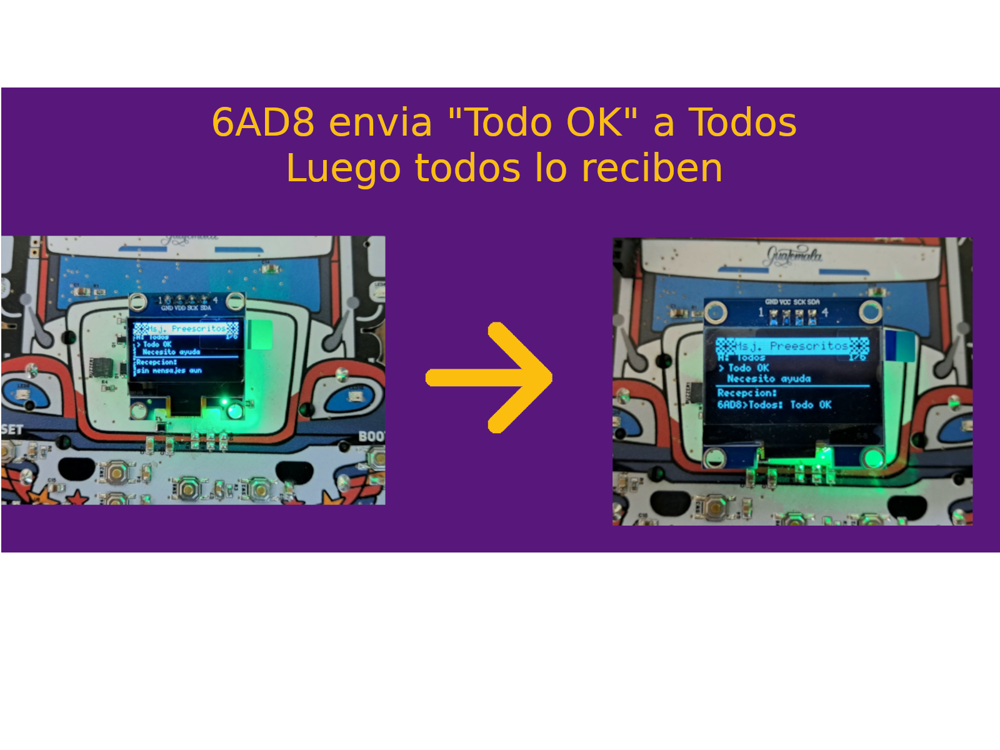
5. En el/los otro(s) Minino(s) Reforjado(s), el mensaje recibido aparece solo, abajo de su propia pantalla (si también tienen la app abierta).
   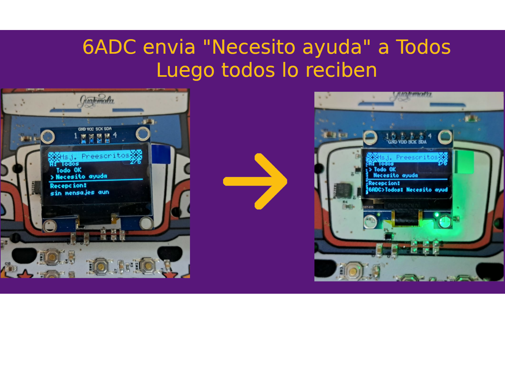

### Opción B: chat de texto libre

Usa [Terminal de Mensajes](#Terminal-de-Mensajes) cuando se deba enviar un mensaje personalizado

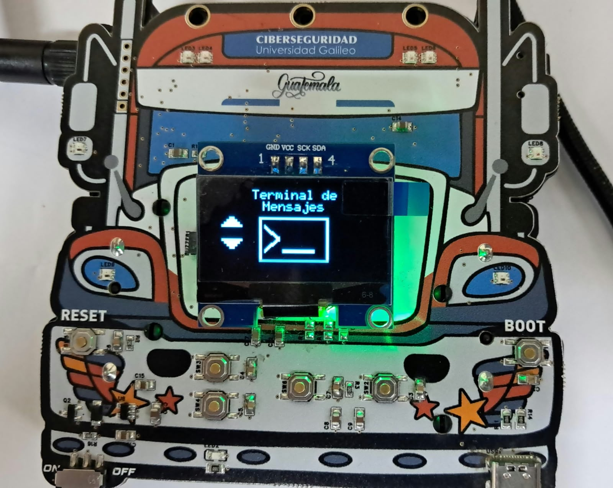

1. Conecta por cable USB el Minino Reforjado desde el que vas a escribir, y abre el monitor serial a 115200 baudios.
2. En ese Minino Reforjado: APPS -> Terminal de Mensajes.
   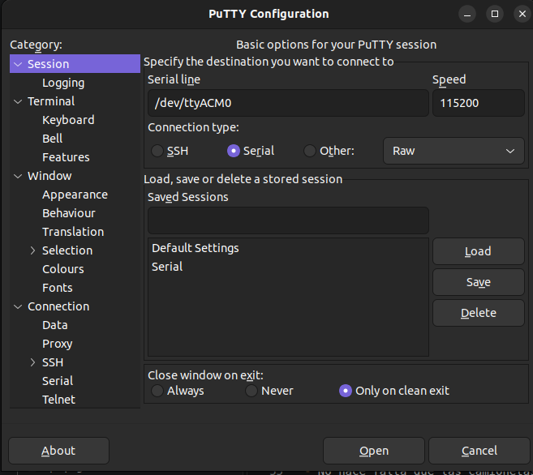
3. Anota tu propio ID que aparece en el banner
   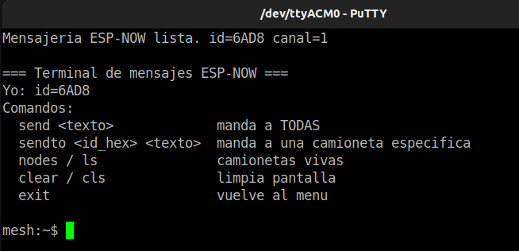
4. En el otro Minino Reforjado, entra también a Terminal de Mensajes o a Mensajes ESP NOW (cualquiera de las dos apps participa en la misma red de mensajería)
   
   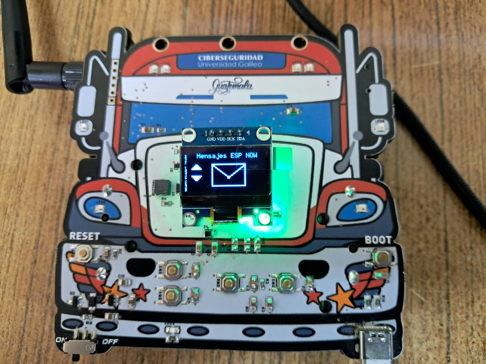
5. Para mandar a todas: `send hola a todos`

- Viendo el mensaje en el Minino Reforjado
  
- Viendo el mensaje en la terminal
  

6. Para mandar a un Minino Reforjado específico: `sendto <su_ID> hola directo` (usa `nodes` o `ls` primero para ver los IDs disponibles).

- Usando ls o nodes
  
- Send especifico (6AD8 -> 6ADC)
  

7. Los mensajes que te lleguen se imprimen solos en el monitor serial, con un beep.
8. `exit` o BACK para salir cuando termines.
   

### Notas generales

- El ESP-NOW solo está activo mientras cualquiera de las dos apps este abierta no funciona en segundo plano ni mientras estás en otra app.
- No hace falta que los Mininos Reforjados estén en la misma red WiFi ni que tengan internet.
- Si un Minino Reforjado no aparece en la lista de destinos o en `nodes`/`ls`, confirma que esté encendido, cerca, y con alguna de las dos apps

## Tutorial: Demo de ALU en RISC V

> **Nota sobre el nombre:** el proyecto se llamó antes *camioneta* El nombre hace referencia a la forma del layout, parecida a una camioneta de Guatemala. Ahora se llama **Minino Reforjado**; algunas capturas de pantalla en esta wiki todavía muestran el nombre anterior.

Como utilizar y como funciona la demostracion de como correr programas en ensamblador [RISC V](https://riscv.org/) desde la ESP32 (valido unicamente para ESP32 que esten hechas en arquitectura RISC V como la C6, C5, C3, H2, P4, S31)

Existen 2 formas para poder ejecutar el Demo de RISC V:

1. Desde las apps del Minino Reforjado
2. Desde la terminal serial

### Usando la aplicacion en pantalla

#### Qué necesitas

Solamente necesitas el Minino Reforjado, ya que corre RISC V nativamente

#### Pasos

1. Desde apps seleccionamos `ALU RISC V`
   
   Una vez dentro configuramos los parametros para hacer una operacion
   
2. Configuramos el primer operando (A)
   
3. Configuramos el segundo operando (B)
   
4. Presionamos listo y vemos el resultado
   

### Usando el puerto serial

#### Qué necesitas

- Cable USB al Minino Reforjado o su conexion remota
- Un monitor serial: el de Arduino IDE, PuTTY, o `screen`/`minicom` en Linux.

#### Velocidad

El Minino Reforjado funciona a **115200 baudios**, 8N1 (8 bits, sin paridad, 1 bit de parada).

*Esta velocidad aplica a todas las terminales por cable del dispositivo*

#### Pasos

1. Conecta el cable USB.
2. Utiliza el puerto serial que prefieras (en este ejemplo se usara *PUTTY* )
3. Configura el puerto serial como se menciona anteriormente, tomando en cuenta la velocidad y el puerto seleccionado
   
   
4. Una vez abierto el puerto serial, en el Minino Reforjado vamos a la seccion de **ajustes** y seleccionamos la **Terminal avanzada** ya que ahi se encuentra la funcionalidad de ALU por medio del puerto serial
   

   En este caso por la complejidad de utilizar una ALU y los parametros que tiene, el demo de ALU tiene su propia seccion de ayuda que se invoca con el siguiente comando:

   ```
   alu help
   ```

   De ahi tenemos disponibles varios comandos para poder utilizar la ALU de 8 bits programada en RISC V 

   | Comando                 | Qué hace                                  |
   | ----------------------- | ------------------------------------------ |
   | `alu help`            | esta ayuda                                 |
   | `alu a <0-255> `      | fija el operando A                         |
   | `alu b <0-255> `      | fija el operando B                         |
   | `alu op <operacion> ` | add, sub, and, or, xor, sll, srl, sltu     |
   | `alu run `            | ejecuta la operacion actual                |
   | `alu all`             | corre las 8 operaciones con A y B actuales |
   | `alu show `           | muestra A, B, OP y el ultimo resultado     |
5. Para este ejemplo ejecutaremos el comando `alu all` ya que este incluye a todas las operaciones disponibles, utilizaremos valores al azar para los operandos A y B

   En este caso usaremos `A = 57` y `B = 101`
   

   Como podemos ver los resultados y respectivas flags vemos que la ALU funciona

Tambien existe una [GUI de Python](#Tutorial-GUI-ALU) para manejar la ALU sin escribir los comandos a mano.

## Tutorial: Demo de cifrado y descifrado AES en ESP32

> **Nota sobre el nombre:** el proyecto se llamó antes *camioneta* El nombre hace referencia a la forma del layout, parecida a una camioneta de Guatemala. Ahora se llama **Minino Reforjado**; algunas capturas de pantalla en esta wiki todavía muestran el nombre anterior.

### Qué necesitas

- Una ESP32 con unidad criptografica de hardware
- Cable USB al Minino Reforjado o su conexion remota
- Un monitor serial: el de Arduino IDE, PuTTY, o `screen`/`minicom` en Linux.

### Velocidad

El Minino Reforjado funciona a **115200 baudios**, 8N1 (8 bits, sin paridad, 1 bit de parada).

*Esta velocidad aplica a todas las terminales por cable del dispositivo*

### Usando el puerto serial

1. Conecta el cable USB.
2. Utiliza el puerto serial que prefieras (en este ejemplo se usara *PUTTY* )
3. Configura el puerto serial como se menciona anteriormente, tomando en cuenta la velocidad y el puerto seleccionado
   
   
4. Open.
   
5. Escribe `help` para ver todos los comandos disponibles.
   
6. Escribe el comando que desees usar

### Comandos disponibles

| Comando               | Qué hace                                                             |
| --------------------- | --------------------------------------------------------------------- |
| `aes help`          | esta ayuda                                                            |
| `aes msg <texto>`   | mensaje a cifrar (hasta 16 caracteres)                                |
| `aes key 0\|1\|<hex>` | clave: preset 0/1, o 32 hex (16 bytes)                                |
| `aes show`          | mensaje y clave actuales                                              |
| `aes run`           | cifra y descifra el mensaje actual (resumen)                          |
| `aes steps`         | cifrado ronda por ronda: SubBytes/ShiftRows/MixColumns/AddRoundKey    |
| `aes keysteps`      | expansión de la clave (key schedule) paso a paso                     |
| `aes attempts`      | intentos con claves casi correctas (se ve el texto que dan, todo mal) |
| `aes avalanche`     | mismo mensaje, 1 bit distinto -> cifrado totalmente distinto          |
| `clear`             | limpiar pantalla                                                      |

### Demo de cifrado paso a paso

Para esta demostracion vamos a cifrar el mensaje `Hola mundo!` y veremos como es que paso a paso se va cifrando segun el cifrado [AES](https://www.geeksforgeeks.org/computer-networks/advanced-encryption-standard-aes/)

Primero debemos definir el mensaje que queremos cifrar, luego podemos ver tanto el mensaje como la clave que cifro


Luego corremos el comando `aes steps`, este comando enseña como es el cifrado paso a paso mostrando las operaciones matriciales necesarias


### Demo de verificacion de claves

Usaremos el comando `aes attempts` para ilustrar como el tener una clave incorrecta por mas minimo que sea la diferencia no podra descifrar el mensaje.

Para este ejemplo se haran varios intentos con claves que son similares y solo cambian en algunos bits


### Demo de cifrado y descifrado

Ya que conocemos la clave y el mensaje cifrado podemos hacer el proceso inverso y volver al mensaje original `Hola mundo!`

Para esto utilizamos el comando `aes run`


## Tutorial: GUI de Python para la ALU

> **Nota sobre el nombre:** el proyecto se llamó antes *camioneta* El nombre hace referencia a la forma del layout, parecida a una camioneta de Guatemala. Ahora se llama **Minino Reforjado**; algunas capturas de pantalla en esta wiki todavía muestran el nombre anterior.

Es una interfaz grafica en `tools/visor_alu.py` que maneja la demo de [ALU RISC-V](#Tutorial-RISCV) por puerto serial, usando los mismos comandos `alu a/b/op/run` de la [Terminal Avanzada](#Ajustes-Terminal-Avanzada).

Muestra A, B y R como registros de 8 bits junto con las flags, en vez de tener que escribir los comandos a mano.

#### Qué necesitas

- Python 3 con `tkinter` (viene incluido por lo general) y la libreria `pyserial`:
  ```
  pip install pyserial
  ```
- El Minino Reforjado conectado por USB.

#### Pasos

1. En el Minino Reforjado, entra a **AJUSTES -> Terminal Avz**
   
2. Edita la constante `PORT` al inicio de `visor_alu.py` con tu puerto serial (`/dev/ttyACM0` en Linux, `COM3` por ejemplo en Windows).
   [GUI](imgs/guialu2.png)
3. Corre el script:

   ```
   python3 tools/visor_alu.py
   ```

   
4. Elegi los operandos **A** y **B**, y la operacion **OP** en el menu desplegable.
   
5. Presiona **Play**. La GUI manda los comandos al Minino Reforjado y muestra el resultado en el registro **R**, junto con las flags `Z N OVF C`.
   

#### Sobre las flags

- **Z** (Zero): se activa cuando el resultado es 0.
- **N** (Negative): solo aplica a `sub` — se activa cuando `A < B`, es decir cuando el resultado real de la resta es negativo. En las demas operaciones siempre es 0.
- **OVF** (Overflow): solo aplica a `add` — se activa cuando `A + B` supera 255 (se sale del rango de 8 bits sin signo). En las demas operaciones siempre es 0.
- **C** (Carry): en `add` es el acarreo de la suma de 8 bits; en `sub` es el "borrow" (se activa si A < B sin signo); en `sll`/`srl` es el ultimo bit que se sale por el corrimiento; en el resto siempre es 0.

#### Si no reconoce la respuesta de la ALU

El script valida la respuesta que llega por serial; si no la reconoce, muestra un error con el texto crudo recibido en vez de crashear. La causa mas comun es que el dispositivo no estaba parado en **Ajustes -> Terminal Avz** cuando se presiono Play.

# Parte V. Addons

## Addons

Módulos externos que se le pueden agregar al Minino Reforjado por UART (directo) o por PCB dedicada usando un puente UART y otro MCU

### Addons con módulos comerciales (UART)

#### LORA

Comunicación inalámbrica de largo alcance (varios kilómetros) y bajo consumo, ideal para telemetría o mensajería entre Mininos Reforjados sin depender de WiFi.

**Módulo RYLR998**

- https://www.pacifiko.com/compras-en-linea/reyax-rylr998-uart-interface-868-915-mhz-lora-module-with-antenna-fcc-ce-ncc-certification
- https://www.dfrobot.com/product-1669.html

**Módulo RYLR896**

- https://www.amazon.com/-/es/REYAX-RYLR896-M%C3%B3dulo-SX1276-Comando/dp/B07NB3BK5H

#### USB HID

Convierte comandos recibidos por UART en eventos de teclado/mouse USB — permite automatizar entradas en una PC conectada por cable, sin drivers.

**Módulo CH9329**

- https://www.amazon.com/-/es/versi%C3%B3n-teclado-completo-Driverless-desarrollo/dp/B0G1KP52PY
- https://guatemaladigital.com/CH9329-Module---UARTTTL-to-USB-HID-Converter-for-Keyboard-and-Mouse-No-Drivers-Needed-for-Game-Development/Producto/30727839

#### RFID/NFC

Lee y escribe tarjetas/tags RFID y NFC de 13.56MHz.

**Módulo PN532**

- https://www.dfrobot.com/product-1917.html
- https://oxdea.gt/product/modulo-lector-rfid-nfc-13-56mhz-pn532/

#### Fibra Óptica

Transmite datos por fibra óptica en vez de cobre — inmune a interferencia electromagnética y útil para distancias largas.

- https://www.dfrobot.com/product-2588.html

#### 4G (llamadas/SMS/datos móviles)

Agrega conectividad celular al Minino Reforjado: llamadas, SMS y datos móviles sin depender de WiFi.

- https://www.dfrobot.com/product-2802.html

#### Impresora térmica

Imprime tickets o etiquetas sin tinta (térmico), útil para recibos o códigos QR impresos en el momento.

- https://www.amazon.com/-/es/Impresora-integrada-impresi%C3%B3n-registradora-autoservicio/dp/B0FCXQPB4V
- https://www.amazon.com/-/es/Impresora-integrada-interfaz-impresi%C3%B3n-etiquetas/dp/B0CJYBRK3M

#### Lector de códigos de barras/QR

Escanea códigos de barras y QR y entrega el resultado como si fuera texto tecleado (o por UART).

- https://www.amazon.com/Bloepum-Barcode-Scanner-Reader-Reminding/dp/B0F4R3R6YK

#### RS485

Protocolo serial diferencial de largo alcance y multipunto, muy usado en automatización industrial — permite varios dispositivos en el mismo bus.

- https://oxdea.gt/product/modulo-max485-conversor-rs485-a-serial-ttl/
- https://www.amazon.com/max485/s?k=max485

#### Reconocimiento de voz

Reconoce comandos de voz preentrenados y los traduce a comandos por UART.

- https://oxdea.gt/product/modulo-de-reconocimiento-de-voz-v3-1-elechouse/
- https://www.amazon.com/-/es/Rakstore-reconocimiento-compatible-Arduino-precisi%C3%B3n/dp/B09D3WHHKN

#### Sensores de distancia (radar de microondas, ultrasonido, LIDAR)

Miden la distancia a un objeto usando distintas tecnologías: radar de microondas, ultrasonido o LIDAR (láser).

- https://www.dfrobot.com/product-1882.html
- https://www.dfrobot.com/product-325.html
- https://www.dfrobot.com/product-1995.html
- https://www.adafruit.com/product/4019

#### Sensor de luz UV

Mide intensidad de luz ultravioleta (UVA/UVB), disponible en versión UART o analógica.

**UART**

- https://uelectronics.com/producto/gravity-ltr390-sensor-de-luz-uv-280nm-430nm-uva-uvb-sen0540/

**Analógico**

- https://www.electronicadiy.com/products/sensor-de-luz-ultravioleta-uvguva-s12sd

#### Sensor de huellas digitales

Captura y compara huellas dactilares para autenticación.

- https://www.dfrobot.com/product-2051.html

#### Sensor de presencia humana

Detecta si hay una persona cerca usando radar de milimétricas (mmWave), incluso si está quieta (a diferencia de un PIR normal).

- https://www.dfrobot.com/product-2793.html

### Addons con PCB dedicada (UART)

La lógica es la siguiente: cuando el sensor o addon usa un protocolo distinto a UART, se hace un puente con otro microcontrolador (Puya, ATTINY, etc):

```
Sensor/Addon → Microcontrolador puente (Puya, ATTINY, etc) → UART
```

#### CAN BUS (SPI)

Permite leer y escribir instrucciones para el protocolo CAN (CAN V2.0B).

- https://www.amazon.com/-/es/MCP2515-TJA1050-CAN-compatible-controlador/dp/B0BVH43P9L
- https://www.pacifiko.com/compras-en-linea/wwzmdib-3-pcs-mcp2515-tja1050-can-bus-module-spi-interface-compatible-with-for-arduino-raspberry-pi-esp32-stm-can-bus-controller-receiver

#### Expansión con STM32 (F103C8 o F303K8)

Permite expandir las capacidades a otro core basado en STM32 con periféricos más potentes y 32 bits.

**STM32F103C8** (Cortex-M3, 72 MHz) — 9 puertos de comunicación (USART, SPI, I²C, USB, CAN), 7 temporizadores, 2 ADC de 12 bits, DMA de 7 canales y hasta 37 pines GPIO.

- https://laelectronica.com.gt/products/board-de-desarrollo-stm32f103c8t6-tipo-c
- https://www.amazon.com/-/es/HiLetgo-STM32F103C8T6-Sistema-Desarrollo-Learning/dp/B07VKSVM21

**STM32F303K8** (Cortex-M4, 72 MHz) — añade FPU y un enfoque analógico avanzado: 1 ADC ultra rápido, 1 DAC, 3 comparadores, 1 amplificador operacional y un temporizador de alta resolución, en un chip de 32 pines (sin USB).

- https://www.digikey.com/en/products/detail/stmicroelectronics/NUCLEO-F303K8/5428805
- https://tienda.tettsa.gt/producto/board-nucleo-stm32f303k8t6/

#### Mini expansión con ATTINY85

Core simple de 8 bits y 6 GPIOs.

- https://tienda.tettsa.gt/producto/microcontrolador-attiny85/
- https://www.amazon.com/-/es/Original-Atmel-ATTINY85-20PU-Tiny85-20Pu-Piezas/dp/B06W9JBJJ6

#### Expansión con PY32

ARM Cortex-M0+ de 32 bits con I2C, SPI, UART, ADC de 12 bits, timers de 16 bits y timer de baja potencia.

#### Módulo RF NRF24L01 2.4GHz (SPI)

Permite transmitir y recibir señales ISM de 2.4 GHz.

- https://www.amazon.com/-/es/HiLetgo-NRF24L01-transceptor-inal%C3%A1mbrico-m%C3%B3dulo/dp/B00WG9HO6Q
- https://laelectronica.com.gt/products/modulo-rf-nrf24l01-24ghz-con-antena

#### Jammer de bocinas Bluetooth (SPI)

Permite cortar la señal contaminando con ruido (mismo módulo NRF24L01 de arriba).

- https://www.amazon.com/-/es/HiLetgo-NRF24L01-transceptor-inal%C3%A1mbrico-m%C3%B3dulo/dp/B00WG9HO6Q
- https://laelectronica.com.gt/products/modulo-rf-nrf24l01-24ghz-con-antena

#### Brújula (I2C)

Magnetómetro de 3 ejes.

- https://oxdea.gt/product/magnetometro-de-3-ejes-hmc5883l-gy-273/
- https://www.amazon.com/-/es/ACEIRMC-QMC5883L-Magnet%C3%B3metro-Potencia-Precisi%C3%B3n/dp/B08T239MLY

#### Contador Geiger (Input Capture)

Sensor de radiación ionizante.

- https://www.dfrobot.com/product-2547.html

#### Sensor de temperatura, humedad y presión atmosférica (SPI/I2C)

Mide temperatura, humedad relativa y presión atmosférica en un solo módulo.

- https://www.dfrobot.com/product-2918.html

#### Sensor de pulso y oxígeno

Mide frecuencia cardiaca y saturación de oxígeno en sangre (SpO2).

- https://www.dfrobot.com/product-2529.html (UART)
- https://oxdea.gt/product/modulo-sensor-de-frecuencia-cardiaca-y-oximetro-de-pulso-max30102/ (I2C)
- https://tienda.tettsa.gt/producto/pulsioximetro-max30102/ (I2C)
